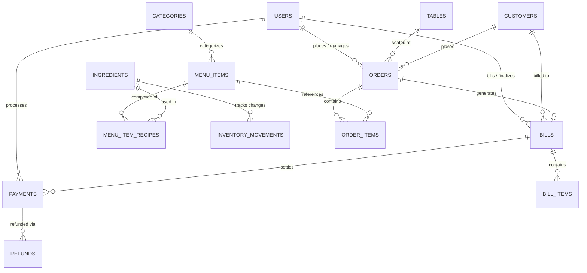

# Database Design & Architecture Specification

## Database: `restaurant_billing_db` (MySQL 8.x)

This document specifies the complete relational schema, table structures, foreign key constraints, indexes, and triggers/business rules for the Restaurant Bill Generator and Management System.

---

## 1. Entity Relationship (ER) Diagram

---

## 2. Relational Schema Summary (15 Core Tables)

| # | Table Name | Description | Key Indexes & Constraints |
|---|------------|-------------|----------------------------|
| 1 | `users` | Staff credentials & RBAC (`ADMIN`, `CASHIER`, `KITCHEN_STAFF`) | `UK: username`, `UK: email` |
| 2 | `categories` | Menu classification hierarchy | `display_order`, `is_active` |
| 3 | `menu_items` | Dishes, prices, dietary tags (`is_veg`), and photos | `FK: category_id`, `is_archived` |
| 4 | `restaurant_tables` | Dining floor plan and seat capacity | `UK: table_number`, `status` |
| 5 | `customers` | Directory of frequent diners & lifetime spending | `UK: phone`, `total_spent` |
| 6 | `orders` | Order lifecycle records (`DINE_IN`, `TAKEAWAY`, `DELIVERY`) | `UK: order_number`, `FK: table_id`, `status` |
| 7 | `order_items` | Line items with quantities, prices, notes | `FK: order_id`, `FK: menu_item_id` |
| 8 | `bills` | Finalized tax invoices with CGST & SGST breakdowns | `UK: bill_number`, `FK: order_id`, `payment_status` |
| 9 | `bill_items` | Snapshot of dish rates at the instant bill was printed | `FK: bill_id`, `FK: menu_item_id` |
| 10 | `payments` | Monetary transactions across Cash, UPI, Card, Other | `UK: payment_number`, `FK: bill_id` |
| 11 | `refunds` | Payment return records and audit trail | `UK: refund_number`, `FK: payment_id` |
| 12 | `ingredients` | Raw materials inventory & minimum safety threshold | `UK: name`, `is_active` |
| 13 | `menu_item_recipes` | Recipe formula linking menu items to ingredients | `FK: menu_item_id`, `FK: ingredient_id` |
| 14 | `inventory_movements` | Stock audit ledger (Purchases, Consumption, Wastage) | `FK: ingredient_id`, `created_at` |
| 15 | `restaurant_settings` | Key-value configuration for GSTIN, legal address, taxes | `PK: setting_key` |

---

## 3. Financial Integrity & Decimal Precision Rules

1. **Currency Representation**:
   All monetary values (`price`, `subtotal`, `cgst_amount`, `sgst_amount`, `grand_total`, `paid_amount`, `balance_amount`) utilize `DECIMAL(12, 2)` to eliminate floating-point rounding errors.

2. **GST Invoicing Formula**:
   $$\text{Taxable Amount} = \text{Subtotal} - \text{Discount Amount}$$
   $$\text{CGST (2.5\%)} = \text{Taxable Amount} \times 0.025$$
   $$\text{SGST (2.5\%)} = \text{Taxable Amount} \times 0.025$$
   $$\text{Grand Total} = \text{Taxable Amount} + \text{CGST} + \text{SGST}$$
   Each calculation is rounded to 2 decimal places using `RoundingMode.HALF_UP`.

3. **Soft Deletions & Referential Integrity**:
   Deleting a menu item does not drop it from SQL; instead, `is_archived = true` is set. This ensures historical bills, tax audits, and receipts remain completely intact without foreign key constraint violations.
